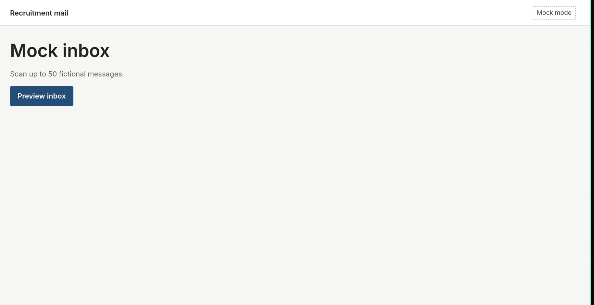
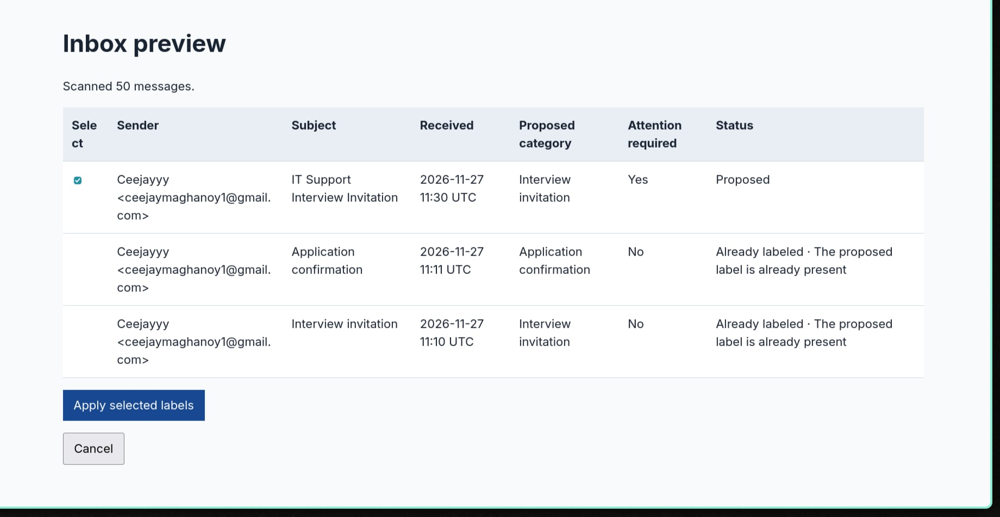
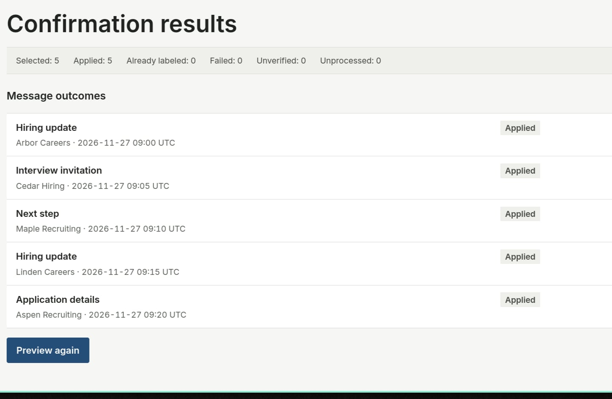

# ame-email


Review recruitment email and apply category labels after confirming your
selection. The recommended portfolio demo uses a fictional inbox and works
offline.

## Features

- Scan up to 50 inbox messages and see which messages need attention.
- Preview proposed labels for application confirmations, interviews,
  assessments, rejections, and response requests.
- Deselect messages before applying labels. Ambiguous messages and conflicting
  labels are flagged for review.
- Inspect per-message results and rescan to reconcile uncertain writes.

## Screenshots


### Inbox preview



### Confirmation results



## Run the mock demo

Use Python 3.11 or newer. From the project root:

```sh
python -m venv .venv
.venv/bin/python -m pip install -e '.[test]'
RECRUITMENT_MAIL_MODE=mock .venv/bin/python -m flask --app recruitment_mail run --host 127.0.0.1 --no-debug --no-debugger --no-reload
```

Open <http://127.0.0.1:5000>, choose **Preview inbox**, review the rows, then
choose **Apply selected labels**. Use **Preview again** to see already-labeled
messages. Restart the app to reset the fictional inbox.

## Stack

Python and Flask serve Jinja templates, native forms, and plain CSS. A
deterministic phrase classifier and an in-memory workflow share a mailbox
interface with mock and Gmail implementations.

## Testing

```sh
.venv/bin/python -m pytest -q
```

All 47 automated tests passed using fictional inboxes and simulated Gmail
requests. On Linux with user namespaces enabled, run the suite with
`unshare -Un .venv/bin/python -B -m pytest -q` to isolate it from the network.

## Optional Gmail integration

A live smoke test passed with a dedicated Gmail test account, including
OAuth, account verification, a 50-message scan, label application, and rescan.

1. Enable the Gmail API in your Google Cloud project. Configure OAuth consent,
   add the dedicated address as a test user if the app is in Testing, and
   create a **Desktop app** OAuth client. Store the downloaded JSON in a
   private directory outside this repository.
   [Google Gmail Python quickstart](https://developers.google.com/workspace/gmail/api/quickstart/python)
2. Install the Gmail extra with `.venv/bin/python -m pip install -e '.[gmail]'`.
3. Launch Gmail mode with your dedicated test address and external client path:

   ```sh
   RECRUITMENT_MAIL_MODE=gmail \
   RECRUITMENT_GMAIL_ACCOUNT='dedicated-test@example.com' \
   RECRUITMENT_GMAIL_CLIENT_FILE='/absolute/path/outside/project/desktop-client.json' \
   .venv/bin/python -m flask --app recruitment_mail run --host 127.0.0.1 --no-debug --no-debugger --no-reload
   ```

4. Open the authorization URL printed in the terminal within three minutes.
   Sign in to the dedicated test account and check the verified address in the
   app before previewing.

The optional [setup wizard](scripts/gmail-smoke-wizard.sh) guides you through
the Cloud setup and prompts separately before connecting and applying a label.

## Security and limitations

- Run locally on loopback with debug mode off. Previews are session-bound,
  expire after 15 minutes, and require CSRF-protected confirmation.
- Gmail account identity is verified before mailbox access. OAuth tokens stay
  in memory, and credential files belong outside the repository. The granted
  `gmail.modify` scope is broader than the app's write path, which only adds
  the approved category label to each confirmed message.
- Classification uses English phrases and can miss unfamiliar wording. Scans
  are limited to 50 inbox messages. Run history and mock label changes reset
  on restart. Rescan before retrying an unverified write.
